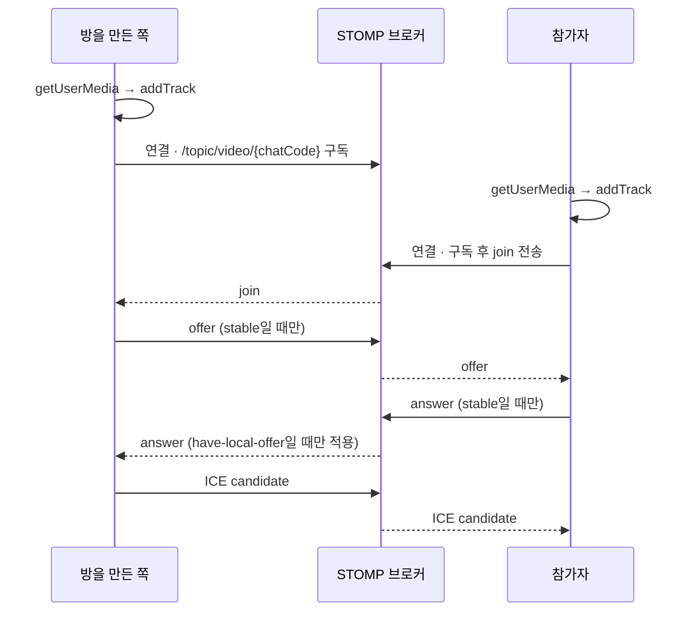
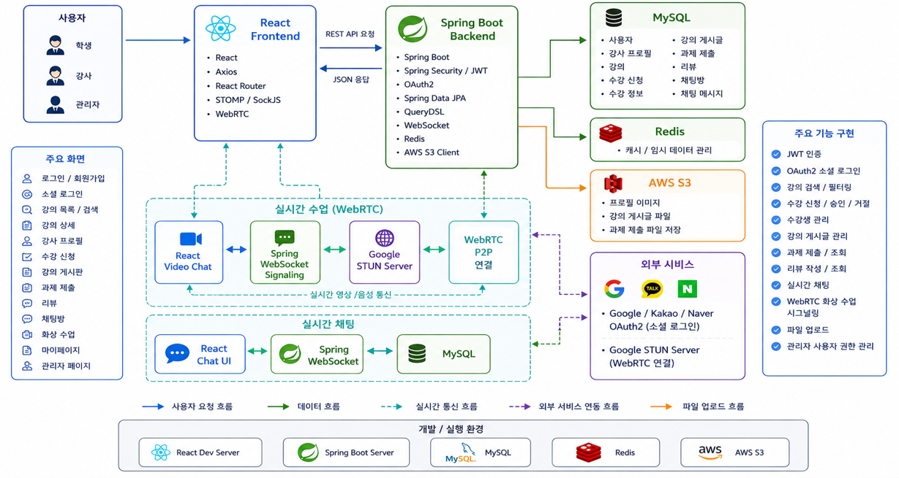

# SayBridge · 화상채팅 기반 외국어 교육 플랫폼

> 외국어 강사와 학생을 실시간으로 연결하는 화상 수업 기반 언어 학습 플랫폼입니다.
> 언어·난이도로 강의를 찾아 수강을 신청하고, 승인 후 1:1 화상 수업과 실시간 채팅, 과제 제출·확인까지 한 서비스에서 이어집니다.

| 기간 | 팀 구성 | 내 역할 |
| --- | --- | --- |
| 2025.01 ~ 2025.05 | 1인 개발 | 프론트엔드 및 백엔드 개발 |

**링크** · [포트폴리오 상세](https://portfolio-sys13-9a4d.vercel.app/projects/saybridge)

> 프로젝트 종료 후 과제 제출 상태 조회와 수강 인원 집계를 **사후 개선**했습니다. 본문에서 해당 내용에 "(사후 개선)"을 붙였습니다.

## 주요 기능

| 기능 | 내용 |
| --- | --- |
| 회원·인증 | 이메일 회원가입(중복 확인)·로그인과 네이버·카카오·구글 OAuth2 로그인을 지원합니다. 로그인하면 JWT를 HttpOnly 쿠키로 발급하고, 비밀번호는 BCrypt로 저장합니다. 역할(USER·TEACHER·ADMIN)에 따라 강사 메뉴를 보여 줍니다. |
| 강의 탐색 | 언어(6종)·난이도(3단계) 조건을 QueryDSL 동적 쿼리로 조합해 검색하고, 전체 강의는 페이지 단위로 조회합니다. |
| 수강 신청·관리 | 학생이 수강을 신청·취소하면 강사가 승인하거나 거절합니다. 강사는 수강생 목록을 확인하고 내보낼 수 있으며, 학생은 수강을 철회할 수 있습니다. 승인·철회·내보내기 때 현재 수강 인원을 갱신하고, 정원이 찬 강의는 승인하지 않습니다(사후 개선). |
| 강의 게시판 | 강사가 강의별 공지·자료 글을 작성·수정·삭제하고, 첨부 파일을 AWS S3에 올립니다. |
| 과제 제출 | 학생이 게시글별 과제 파일을 S3에 올려 제출·재제출·취소하고, 강사는 게시글별 제출자·제출 시각·파일을 확인합니다. |
| 1:1 화상 수업 | 방을 만들면 방 코드가 발급되고, 상대가 코드로 입장하면 WebRTC P2P로 영상·음성을 연결합니다. Offer·Answer·ICE 후보는 STOMP로 주고받습니다. |
| 실시간 채팅 | 화상 수업 화면에서 STOMP로 메시지를 주고받습니다. 메시지는 MySQL에 저장하고, 채팅방별 메시지 ID를 Redis 리스트에 기록합니다. |
| 강사 프로필·리뷰 | 강사가 프로필(사진·소개·태그·언어)을 관리하고 강의를 개설합니다. 수강생이 남긴 리뷰(평점·내용)는 마이페이지와 강사 프로필에서 확인합니다. |
| 관리자 | 회원 목록 조회, 역할 변경, 회원 삭제를 제공합니다. 역할을 TEACHER로 바꾸면 강사 프로필을 함께 생성합니다. |
| 신규 강의 메일 알림 | 이메일 구독 API와 강의 생성 이벤트 리스너로 구독자에게 새 강의 정보를 메일로 보냅니다. (화면 연동 없이 API만 구현) |

## 내가 맡은 부분

1인 개발로 프론트엔드와 백엔드를 모두 구현했습니다. 화상 수업의 연결이 매번 같은 순서로 맺어지도록 시그널링 흐름을 통제하는 데 집중했습니다.

**프로젝트 기간**

- **실시간 수업**: SockJS·STOMP 엔드포인트(`/ws-chat`)와 Simple Broker 구성, 채팅 메시지 저장·브로드캐스트, 시그널링 메시지 중계, React에서 `RTCPeerConnection` 협상 흐름 구현
  - [WebSocketConfig.java](backend/src/main/java/com/backend/config/WebSocketConfig.java), [VideoSignalController.java](backend/src/main/java/com/backend/controller/VideoSignalController.java), [ChatService.java](backend/src/main/java/com/backend/service/ChatService.java), [VideoChat.js](frontend/src/pages/VideoChat.js), [ChatRoom.js](frontend/src/pages/ChatRoom.js)
- **인증**: Spring Security 필터 체인, 쿠키에서 JWT를 꺼내 검증하는 필터, 네이버·카카오·구글 사용자 정보 매핑
  - [SecurityConfig.java](backend/src/main/java/com/backend/config/SecurityConfig.java), [JwtAuthenticationFilter.java](backend/src/main/java/com/backend/config/JwtAuthenticationFilter.java), [CustomOAuth2UserService.java](backend/src/main/java/com/backend/service/CustomOAuth2UserService.java)
- **강의 검색**: QueryDSL `BooleanBuilder`로 언어·난이도 조건이 있을 때만 where 절에 추가하고, 결과를 DTO Projection으로 조회
  - [CourseRepositoryImpl.java](backend/src/main/java/com/backend/repository/CourseRepositoryImpl.java)
- **파일 업로드**: AWS SDK v2 `S3Client`로 프로필 이미지·게시글 첨부·과제 파일을 업로드하고, 다시 올리면 기존 객체를 삭제
  - [S3Service.java](backend/src/main/java/com/backend/service/S3Service.java), [FileStorageService.java](backend/src/main/java/com/backend/service/FileStorageService.java)
- **REST API**: 강의, 수강 신청·승인, 수강생, 게시글, 과제, 리뷰, 강사 프로필, 관리자
- **React 화면**: 소개(홈), 회원가입·로그인, 강의 목록·상세, 게시글 작성, 마이페이지, 강사 프로필, 화상 수업·채팅, 관리자

**사후 개선 (프로젝트 종료 후)**

- 과제 제출 상태를 게시글 ID 목록으로 한 번에 조회 ([문제 해결 2](#2-과제-제출-상태를-게시글마다-조회하던-문제-사후-개선))
- 수강 승인·철회·내보내기 때 `Course.currentStudents`를 증감하고, 정원 초과나 0명 아래로 내려가는 경우 예외 처리
  - [Course.java](backend/src/main/java/com/backend/entity/Course.java), [CourseApplicationService.java](backend/src/main/java/com/backend/service/CourseApplicationService.java), [CourseEnrollmentService.java](backend/src/main/java/com/backend/service/CourseEnrollmentService.java)
- 소셜 로그인 버튼의 백엔드 주소를 `REACT_APP_API_URL` 환경 변수로 변경

## 문제 해결

### 1. WebRTC 협상 순서 안정화

- **문제**: 미디어 스트림 준비, STOMP 연결, 상대방 입장과 Offer 생성이 서로 다른 비동기 흐름에서 실행됐습니다. Offer/Answer 시그널링은 진행돼도 연결 시점에 따라 상대방 영상이 표시되지 않는 경우가 있었습니다.
- **원인**: `getUserMedia` → `addTrack` → STOMP 연결 → 상대방 `join` → `createOffer` 순서를 나눠 추적했습니다. 로컬 스트림 준비와 STOMP 연결이 분리돼 있고, 상대방 준비 여부와 관계없이 협상이 시작될 수 있어 PeerConnection 상태에 따라 결과가 달라졌습니다.
- **해결**: 초기 협상을 하나의 순서로 고정했습니다.
  1. 로컬 미디어를 먼저 확보해 트랙을 PeerConnection에 등록한 뒤 STOMP를 연결합니다.
  2. 방 코드로 들어온 참가자는 `/topic/video/{chatCode}`를 구독한 뒤 `join`을 한 번만 보냅니다.
  3. 방을 만든 쪽은 `join`을 받았을 때 `signalingState`가 `stable`이고 협상 중이 아닐 때만 Offer를 만듭니다.
  4. 참가자는 `stable` 상태에서만 Answer를 만들고, 방을 만든 쪽은 `have-local-offer` 상태에서만 Answer를 적용합니다. ICE 후보는 같은 토픽으로 주고받습니다.
  - 서버의 `VideoSignalController`는 `/app/video.signal`로 받은 메시지를 `/topic/video/{chatCode}`로 그대로 전달하는 역할만 맡습니다.
- **결과**: 초기 협상 순서를 하나의 흐름으로 통제해 연결 시점에 따른 불안정성을 줄였습니다. 시그널링 성공 여부뿐 아니라 트랙 등록과 PeerConnection 상태를 함께 확인하도록 했습니다.



코드: [VideoChat.js](frontend/src/pages/VideoChat.js) · [VideoSignalController.java](backend/src/main/java/com/backend/controller/VideoSignalController.java) · [WebSocketConfig.java](backend/src/main/java/com/backend/config/WebSocketConfig.java)

### 2. 과제 제출 상태를 게시글마다 조회하던 문제 (사후 개선)

- **문제**: 강의 상세 화면은 게시글별 과제 제출 여부를 표시하려고 게시글 ID 목록을 한 번에 보내지만, 서버는 게시글마다 `findByStudentIdAndCoursePostId`를 호출해 게시글 수만큼 쿼리가 실행됐습니다.
- **해결**: `h.coursePost.id in :coursePostIds` 조건의 JPQL 한 번으로 학생의 제출 내역을 조회합니다. 엔티티 대신 `coursePostId`·`attachmentUrl` 두 값만 인터페이스 Projection([`HomeworkAttachmentProjection`](backend/src/main/java/com/backend/dto/HomeworkAttachmentProjection.java))으로 받아 Map으로 변환하고, 게시글 ID가 비어 있으면 쿼리를 실행하지 않습니다.
- **결과**: 게시글 수와 관계없이 제출 상태를 쿼리 1회로 조회합니다. Mockito 단위 테스트로 일괄 조회를 한 번 호출하고 게시글별 개별 조회는 호출하지 않는지, 빈 목록이면 쿼리를 생략하는지 검증했습니다.

코드: [HomeworkRepository.java](backend/src/main/java/com/backend/repository/HomeworkRepository.java) · [HomeworkService.java](backend/src/main/java/com/backend/service/HomeworkService.java) · [HomeworkServiceTest.java](backend/src/test/java/com/backend/service/HomeworkServiceTest.java)

## 기술 스택

| 구분 | 기술 |
| --- | --- |
| Backend | Java 17, Spring Boot 3.4.1, Spring MVC, Spring Security, OAuth2 Client, Spring WebSocket(STOMP·SockJS), Spring Data JPA, QueryDSL 5.0.0, jjwt 0.11.5, Spring Mail, springdoc-openapi 2.2.0, Lombok, Gradle 8.11.1 |
| Frontend | React 19, Create React App(react-scripts 5.0.1), React Router 7, styled-components 6, Axios, @stomp/stompjs 7, sockjs-client, Context API |
| Realtime | WebRTC(브라우저 `RTCPeerConnection`), Google STUN 서버, STOMP Simple Broker |
| Data / Infra | MySQL, Redis(Lettuce), AWS S3(AWS SDK for Java v2) |
| Test | JUnit 5, Mockito |

## 아키텍처



- 영상·음성은 브라우저 간 P2P로 전달하고, 서버는 시그널링 중계와 영속 데이터만 맡도록 역할을 나눴습니다. ICE 후보 수집에는 Google STUN 서버를 사용합니다.
- React는 REST API(`/api/**`, 화상 수업 방 생성은 `/chatrooms`)와 SockJS 엔드포인트(`/ws-chat`)로 Spring Boot에 연결합니다. 인증은 HttpOnly `jwt` 쿠키로 처리하고, `JwtAuthenticationFilter`가 요청마다 쿠키의 토큰을 검증합니다.
- STOMP 메시지는 클라이언트가 `/app/chat.sendMessage`, `/app/video.signal`로 보내고, 서버가 `/topic/chatroom/{chatCode}`, `/topic/video/{chatCode}`로 전달합니다.
- MySQL에는 사용자·강의·수강 신청·수강·게시글·과제·리뷰·채팅방·채팅 메시지를, S3에는 프로필 이미지·게시글 첨부·과제 파일을 저장합니다. 그림에서 Redis는 '캐시 / 임시 데이터 관리'로 표시돼 있지만, 현재 코드에서는 채팅방별로 저장된 메시지 ID 목록을 기록하는 데만 사용합니다.

### 주요 API

기본 주소는 `http://localhost:8080`입니다.

| 도메인 | 엔드포인트 |
| --- | --- |
| 인증 | `POST /api/auth/signup`, `POST /api/auth/login`, `POST /api/auth/logout`, `GET /api/auth/email-exists`, `POST /api/auth/verify-password`, `GET /oauth2/authorization/{naver\|kakao\|google}` |
| 회원 | `GET /api/user/me`, `PATCH /api/user/update`, `DELETE /api/user/delete` |
| 강의 | `GET /api/course`, `GET /api/course/search?language=&level=`, `GET /api/course/{courseId}`, `POST /api/course/create`, `PATCH /api/course/update/{courseId}`, `DELETE /api/course/delete/{courseId}`, `GET /api/course/student/list`, `GET /api/course/teacher/{teacherId}` |
| 수강 신청 | `POST /api/application/apply/{courseId}`, `GET /api/application/list/{courseId}`, `DELETE /api/application/accept/{applicationId}`, `DELETE /api/application/reject/{applicationId}`, `GET /api/application/my` |
| 수강생 | `GET /api/enrollment/list/{courseId}`, `DELETE /api/enrollment/withdraw/{courseId}`, `DELETE /api/enrollment/expel/{enrollmentId}` |
| 게시글 | `GET /api/post/{courseId}`, `POST /api/post/create`, `PATCH /api/post/update/{coursePostId}`, `DELETE /api/post/delete/{postId}` |
| 과제 | `POST /api/homework/submit/{coursePostId}`, `DELETE /api/homework/{coursePostId}`, `GET /api/homework/submissions?postIds=`, `GET /api/homework/post/{coursePostId}/submissions` |
| 파일(S3) | `POST /api/files/profile`, `POST /api/files/teacher/profile`, `POST /api/files/coursePost/{coursePostId}`, `POST /api/files/homework/{coursePostId}` |
| 리뷰 · 강사 | `/api/review` (내 리뷰·강의별·강사별 조회, 작성, 삭제), `GET /api/teacher/{teacherId}`, `PATCH /api/teacher/update` |
| 관리자 | `GET /api/admin/users`, `PUT /api/admin/users/{id}/role`, `DELETE /api/admin/users/{id}` |
| 구독 | `POST /api/subscribers/subscribe` |
| 화상 수업 · 채팅 | `POST /chatrooms?maxParticipants=`, SockJS `/ws-chat`, STOMP `/app/chat.sendMessage` → `/topic/chatroom/{chatCode}`, `/app/video.signal` → `/topic/video/{chatCode}` |

## 실행 방법

**필요 환경**: JDK 17, Node.js(npm), MySQL, Redis, AWS S3 버킷, SMTP 메일 계정, 소셜 로그인용 OAuth2 클라이언트(네이버·카카오·구글)

### 1. 백엔드

설정 파일 `backend/src/main/resources/application.properties`는 Git에 올라가지 않으므로 직접 만들어야 합니다. 코드에서 읽는 키는 다음과 같습니다.

```properties
# MySQL (스키마 SQL이 없으므로 JPA가 엔티티 기준으로 테이블을 생성)
spring.datasource.url=jdbc:mysql://localhost:3306/<database>
spring.datasource.username=<user>
spring.datasource.password=<password>
spring.jpa.hibernate.ddl-auto=update

# JWT: Base64로 인코딩한 32바이트 이상 키(예: openssl rand -base64 32), 만료 시간(ms)
jwt.secret=<base64-secret>
jwt.expiration-time=<millis>

# 프론트엔드 주소: CORS, WebSocket 허용 Origin, 소셜 로그인 후 리다이렉트에 사용
frontend.ip=http://localhost:3000
# 로그아웃 시 쿠키를 지울 도메인
domain=localhost

# AWS S3
aws.s3.access-key=<access-key>
aws.s3.secret-key=<secret-key>
aws.s3.region=<region>
aws.s3.bucket-name=<bucket>
# TEACHER 역할 지정 시 만드는 강사 프로필의 기본 이미지 URL
basic.image=<image-url>

# 메일: spring.mail.host가 없으면 메일 발송 빈이 만들어지지 않아 서버가 시작되지 않음
spring.mail.host=<smtp-host>
spring.mail.port=<smtp-port>
spring.mail.username=<email>
spring.mail.password=<password>
spring.mail.properties.mail.smtp.auth=true
spring.mail.properties.mail.smtp.starttls.enable=true
```

<details>
<summary>OAuth2 클라이언트 설정 예시 (네이버·카카오·구글)</summary>

`CustomOAuth2UserService`는 registration ID가 `naver`, `kakao`, `google`인 경우만 처리합니다. 각 개발자 콘솔에 리다이렉트 URI `http://localhost:8080/login/oauth2/code/{registrationId}`를 등록합니다.

```properties
spring.security.oauth2.client.registration.google.client-id=<client-id>
spring.security.oauth2.client.registration.google.client-secret=<client-secret>
spring.security.oauth2.client.registration.google.scope=profile,email

spring.security.oauth2.client.registration.naver.client-id=<client-id>
spring.security.oauth2.client.registration.naver.client-secret=<client-secret>
spring.security.oauth2.client.registration.naver.authorization-grant-type=authorization_code
spring.security.oauth2.client.registration.naver.redirect-uri={baseUrl}/login/oauth2/code/{registrationId}
spring.security.oauth2.client.registration.naver.scope=name,email,nickname
spring.security.oauth2.client.provider.naver.authorization-uri=https://nid.naver.com/oauth2.0/authorize
spring.security.oauth2.client.provider.naver.token-uri=https://nid.naver.com/oauth2.0/token
spring.security.oauth2.client.provider.naver.user-info-uri=https://openapi.naver.com/v1/nid/me
spring.security.oauth2.client.provider.naver.user-name-attribute=response

spring.security.oauth2.client.registration.kakao.client-id=<rest-api-key>
spring.security.oauth2.client.registration.kakao.client-secret=<client-secret>
spring.security.oauth2.client.registration.kakao.client-authentication-method=client_secret_post
spring.security.oauth2.client.registration.kakao.authorization-grant-type=authorization_code
spring.security.oauth2.client.registration.kakao.redirect-uri={baseUrl}/login/oauth2/code/{registrationId}
spring.security.oauth2.client.registration.kakao.scope=profile_nickname
spring.security.oauth2.client.provider.kakao.authorization-uri=https://kauth.kakao.com/oauth/authorize
spring.security.oauth2.client.provider.kakao.token-uri=https://kauth.kakao.com/oauth/token
spring.security.oauth2.client.provider.kakao.user-info-uri=https://kapi.kakao.com/v2/user/me
spring.security.oauth2.client.provider.kakao.user-name-attribute=id
```

</details>

Redis는 [RedisConfig.java](backend/src/main/java/com/backend/config/RedisConfig.java)가 기본 `LettuceConnectionFactory`를 쓰므로 `localhost:6379`로 연결하며, 채팅 메시지를 보낼 때 필요합니다.

```bash
cd backend
./gradlew bootRun        # http://localhost:8080
```

### 2. 프론트엔드

```bash
cd frontend
echo "REACT_APP_API_URL=http://localhost:8080" > .env
npm install
npm start                # http://localhost:3000
```

Axios 요청과 SockJS 연결, 소셜 로그인 버튼은 모두 `REACT_APP_API_URL`을 기준으로 백엔드에 접속합니다.

### 3. 화상 수업 확인

1. 서로 다른 브라우저(또는 시크릿 창)에서 두 계정으로 로그인합니다.
2. 한쪽에서 **Video Chat → Create Room**으로 방을 만들면 화면에 방 코드가 표시됩니다.
3. 다른 쪽에서 방 코드를 입력하고 **Join Room**을 누르면 영상과 채팅이 연결됩니다. 방을 만든 쪽이 먼저 화면에 들어와 있어야 참가자의 `join`을 받아 협상을 시작합니다.

브라우저는 HTTPS 또는 `localhost`에서만 카메라·마이크 접근을 허용하므로, 다른 기기에서 접속해 확인하려면 프론트엔드를 HTTPS로 띄워야 합니다.

가입한 계정의 기본 역할은 USER입니다. 강의를 개설하려면 관리자 화면(`/updateRole`)에서 역할을 TEACHER로 바꾸면 강사 프로필이 함께 만들어집니다.

### 4. 테스트

```bash
cd backend
./gradlew test --tests "com.backend.service.HomeworkServiceTest"   # DB 없이 Mockito로 실행
```

## 폴더 구조

```text
SayBridge/
├── backend/                     # Spring Boot API (Gradle)
│   └── src/main/java/com/backend/
│       ├── controller/          # REST API, STOMP 메시지 핸들러(채팅·시그널링)
│       ├── service/             # 비즈니스 로직, S3 업로드, OAuth2 사용자 처리, 메일 알림
│       ├── repository/          # Spring Data JPA, QueryDSL 강의 검색
│       ├── entity/              # JPA 엔티티
│       ├── dto/
│       ├── config/              # Security, JWT 필터, WebSocket, Redis, S3, QueryDSL, CORS
│       ├── event/               # 강의 생성 이벤트
│       └── util/                # JWT 발급·검증
├── frontend/                    # React (Create React App)
│   └── src/
│       ├── pages/               # 강의 목록·상세, 마이페이지, 강사 프로필, 화상 수업·채팅, 관리자
│       ├── api/                 # Axios API 모듈
│       ├── context/             # 로그인 상태(AuthContext), PrivateRoute
│       └── component/           # Header, Footer
└── docs/images/                 # README 이미지
```
